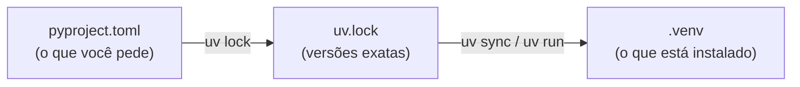

# 01-1. Ambiente do projeto com uv

## Objetivos desta aula

Ao final desta aula você vai entender:

- o que é um **ambiente de projeto** e por que cada projeto deve ter o seu;
- como o **manifesto do projeto** (`pyproject.toml`) descreve o Python e as bibliotecas de que o projeto precisa;
- o que é o **lockfile** (`uv.lock`) e por que ele garante que o treino rode igual em qualquer máquina.

E vai ter construído:

- um ambiente novo com Python 3.13 e as bibliotecas do treino (pandas, numpy, scikit-learn, Optuna, matplotlib, seaborn);
- um grupo de ferramentas de desenvolvimento (pytest, ruff, MkDocs);
- um lockfile com as versões exatas de tudo.

**Vitória da aula:** você abre este próprio curso com `uv run mkdocs serve`, usando o ambiente que acabou de criar.

## Onde estamos

Esta é a primeira aula. Se ainda não leu a [página inicial](index.md), comece por lá: ela explica como
usar o curso e mostra o mapa das aulas. O ticket 01 (scaffolding) foi dividido em três aulas porque traz
conceitos novos demais para uma só: esta (ambiente), a 01-2 (pacote `src/` e primeiro teste) e a 01-3
(ruff e notebook ligado ao ambiente).

## Antes de começar

Você precisa de um terminal aberto na pasta do projeto (`mqtt_under_attack`) e do `uv` instalado.

!!! info "Caso nunca tenha usado o uv"

    --8<-- "course/includes/instalar-uv.md"

Confira com:

```bash title="$ Execução no terminal (na pasta do projeto)"
uv --version
```

```text title="Saída esperada"
uv 0.11.17 (x86_64-unknown-linux-gnu)
```

**O que aconteceu:** o terminal encontrou o programa `uv` e mostrou a versão. A sua pode ser mais nova;
qualquer versão 0.11 ou posterior serve.

## Conceitos

### Ambiente de projeto

Um **[ambiente de projeto](glossario.md#ambiente-de-projeto)** é uma pasta (`.venv`) com um Python e as
bibliotecas de **um único projeto**, separada do Python do sistema e dos outros projetos.

Pense numa bancada de laboratório reservada para um experimento: os reagentes e as versões de cada
instrumento ficam ali, e mexer na bancada ao lado não altera o resultado deste experimento.

O problema que resolve: sem isolamento, atualizar o pandas para outro projeto pode quebrar este, e você
não sabe mais com quais versões o resultado do paper foi gerado. Hoje o projeto já tem um `.venv`, mas ele
foi criado à mão com `pip`, usa Python 3.14 e mistura 170 pacotes do treino e da API. O `uv` cria e mantém
o ambiente sozinho a partir do manifesto, e você não edita a pasta à mão.

Fonte: [uv — Project structure and files](https://docs.astral.sh/uv/concepts/projects/layout/)
("It is not recommended to include the `.venv` directory in version control").

### Manifesto do projeto (`pyproject.toml`)

O **[manifesto do projeto](glossario.md#manifesto-do-projeto)** é o arquivo `pyproject.toml`: a ficha
técnica que diz o nome do projeto, quais versões do Python ele aceita (`requires-python`) e de quais
bibliotecas ele depende (`dependencies`).

É como a seção de materiais e métodos de um artigo: quem lê sabe exatamente o que é preciso para
reproduzir o trabalho.

O manifesto tem tabelas. `[project]` guarda os metadados e as dependências do treino. `[dependency-groups]`
guarda grupos de ferramentas que só você usa enquanto desenvolve (o grupo `dev`: testes, lint,
documentação), que não fazem parte do que o treino precisa para rodar. `[build-system]` diz como empacotar
o projeto. Sem essa tabela, o `uv` instala só as dependências, não o projeto em si. É exatamente o que
queremos nesta aula, porque o pacote `mqtt_dos` só nasce na aula 01-2.

Fontes: [Python Packaging User Guide — Writing your pyproject.toml](https://packaging.python.org/en/latest/guides/writing-pyproject-toml/);
[uv — Managing dependencies](https://docs.astral.sh/uv/concepts/projects/dependencies/);
[uv — Configuring projects](https://docs.astral.sh/uv/concepts/projects/config/)
("If a build system is not defined, uv will not attempt to build or install the project itself, just its dependencies").

### Lockfile e sincronização

O **[lockfile](glossario.md#lockfile)** (`uv.lock`) registra a versão **exata** de cada pacote instalado,
inclusive os que você não pediu diretamente (o scikit-learn traz o joblib e o scipy, por exemplo). O
manifesto diz "pandas 3.0.6 ou mais novo"; o lockfile diz "pandas 3.0.6, este arquivo, este hash".

**[Sincronizar](glossario.md#sincronizacao)** (`uv sync`) é deixar o ambiente igual ao lockfile: instala o que
falta e **remove** o que sobra. O `uv run` faz isso automaticamente antes de cada comando.

É o lote do reagente anotado no caderno: com ele, outra pessoa compra exatamente o mesmo material.



O lockfile vai para o git; o `.venv` não. Com o lockfile, qualquer máquina recria o mesmo ambiente.

Fontes: [uv — Locking and syncing](https://docs.astral.sh/uv/concepts/projects/sync/)
("uv sync performs 'exact' syncing by default, which means it will remove any packages that are not present
in the lockfile"); [uv — Python versions](https://docs.astral.sh/uv/concepts/python-versions/).

## Ponte teoria → projeto

O ticket [01](issues/01-scaffolding.md) pede um ambiente reproduzível com Python 3.13, as dependências do
treino e um grupo dev. A decisão 16 do [log de decisões](decisions.md) escolheu o `uv` com tudo declarado no
`pyproject.toml`. A história de usuário 19 da [especificação](issues/0000-spec-treino-unificado.md) pede um
manifesto do run com as versões das bibliotecas, e o lockfile é a base disso.

Para a sua missão, isso responde a uma pergunta que todo revisor faz: "com quais versões exatas este
resultado foi obtido?". A partir desta aula, a resposta está num arquivo versionado.

## Mão na massa

### Passo 1 — Guardar o ambiente antigo

O `uv` vai criar um `.venv` novo, e o atual (Python 3.14, criado com `pip`) seria substituído. Renomeá-lo
em vez de apagá-lo mantém seus notebooks antigos funcionando com o kernel antigo e torna o passo reversível.

```bash title="$ Execução no terminal (na pasta do projeto)"
mv .venv .venv-legacy
ls -d .venv*
```

```text title="Saída esperada"
.venv-legacy
```

**O que aconteceu:** a pasta mudou de nome. Ela já tem um `.gitignore` interno criado pelo próprio Python,
então continua fora do git sem você precisar fazer nada.

### Passo 2 — Ajustar o manifesto

Abra o `pyproject.toml`. O começo dele está assim hoje:

```toml title="pyproject.toml (antes)" linenums="1"
[build-system]
requires = ["flit_core >=3.2,<4"]
build-backend = "flit_core.buildapi"

[project]
name = "mqtt_under_attack"
version = "0.0.1"
```

Apague as três linhas do `[build-system]` e a linha em branco depois delas. Depois troque o
`requires-python` e apague o comentário `# No [project.dependencies] here on purpose...` (as três linhas
que começam com `#` logo abaixo dele), porque agora as dependências vão morar aqui. O começo do arquivo
fica assim (as seções `[tool.ruff]` abaixo dele não mudam):

```toml title="pyproject.toml" linenums="1" hl_lines="12"
[project]  # (1)!
name = "mqtt_under_attack"
version = "0.0.1"
description = "ML pipeline for detecting DoS attacks in MQTT networks"
authors = [
  { name = "William-SWS" },
]
readme = "README.md"
classifiers = [
    "Programming Language :: Python :: 3",
]
requires-python = ">=3.13,<3.14"  # (2)!
```

1.  O arquivo agora começa direto em `[project]`. O `[build-system]` antigo pedia ao flit que empacotasse
    um módulo `mqtt_under_attack` que não existe no repositório, e o `uv` falharia ao tentar instalá-lo
    (veja Erros comuns). Na aula 01-2 voltamos com um `[build-system]` novo, apontando para o pacote `mqtt_dos`.
2.  Aceita qualquer Python 3.13 (3.13.0, 3.13.13, ...) e recusa o 3.14. O pino exato `==3.13.9` quebraria
    assim que essa versão específica não estivesse disponível; a versão exata usada fica registrada no
    lockfile, que é o lugar certo para ela.

### Passo 3 — Fixar a versão do Python

Agora dizemos ao `uv` qual Python usar neste projeto. Ele grava a escolha num arquivo pequeno,
`.python-version`, que também vai para o git.

```bash title="$ Execução no terminal (na pasta do projeto)"
uv python pin 3.13
```

```text title="Saída esperada"
Pinned `.python-version` to `3.13`
```

**O que aconteceu:** o `uv` criou o `.python-version` com o texto `3.13`. Se você não tiver Python 3.13 na
máquina, ele baixa uma versão gerenciada sozinho no próximo passo.

### Passo 4 — Adicionar as bibliotecas do treino

O `uv add` faz três coisas de uma vez: escreve a dependência no manifesto, resolve as versões no lockfile
e instala tudo no ambiente.

??? question "Pare e pense: você vai pedir 6 bibliotecas. Quantos pacotes acha que serão instalados?"

    28. Cada biblioteca traz as suas próprias dependências (o Optuna traz o SQLAlchemy e o Alembic; o
    scikit-learn traz o scipy e o joblib). É por isso que o lockfile existe: registra também tudo o que você
    não pediu diretamente.

```bash title="$ Execução no terminal (na pasta do projeto)"
uv add pandas numpy scikit-learn optuna matplotlib seaborn
```

```text title="Saída esperada (trecho; linhas de download e tempos variam)"
Using CPython 3.13.13
Creating virtual environment at: .venv
Resolved 31 packages in 623ms
...
Installed 28 packages in 89ms
 + alembic==1.20.0
 ...
 + matplotlib==3.11.2
 + numpy==2.5.4
 + optuna==5.0.0
 + pandas==3.0.6
 ...
 + scikit-learn==1.9.1
 + scipy==1.18.1
 + seaborn==0.13.2
 ...
```

**O que aconteceu:** o `uv` escolheu um Python 3.13 (aqui o 3.13.13), criou o `.venv` novo e instalou 28
pacotes. As versões podem ser mais novas na sua máquina. Em alguns sistemas aparece também um aviso
`Failed to hardlink files; falling back to full copy`, que é inofensivo: só significa que o `uv` copiou os
arquivos em vez de criar atalhos para o cache.

### Passo 5 — Adicionar as ferramentas de desenvolvimento

Agora o grupo `dev`: pytest (testes, aula 01-2), ruff (estilo de código, aula 01-3) e MkDocs com o tema
Material (este curso). O `--dev` coloca essas ferramentas fora das dependências do treino.

```bash title="$ Execução no terminal (na pasta do projeto)"
uv add --dev pytest ruff "mkdocs<2" mkdocs-material
```

```text title="Saída esperada (trecho)"
...
 + mkdocs==1.6.1
 ...
 + mkdocs-material==9.7.7
 ...
 + pytest==9.1.1
 ...
 + ruff==0.17.0
 ...
```

**O que aconteceu:** mais 28 pacotes (o MkDocs e o tema Material trazem Jinja, Markdown, requests e outros). As aspas em `"mkdocs<2"` são obrigatórias: sem elas, o terminal
entenderia o `<` como redirecionamento de arquivo. O limite `<2` existe porque o MkDocs 2.0 quebra temas e
plugins, e o tema deste curso ainda não funciona nele.

### Passo 6 — Ler o que o uv escreveu

Abra o `pyproject.toml` de novo. Você não editou estas linhas: foi o `uv add` que as escreveu.

```toml title="pyproject.toml (trecho)" linenums="12"
requires-python = ">=3.13,<3.14"
dependencies = [  # (1)!
    "matplotlib>=3.11.2",
    "numpy>=2.5.4",
    "optuna>=5.0.0",
    "pandas>=3.0.6",
    "scikit-learn>=1.9.1",
    "seaborn>=0.13.2",
]
```

1.  Cada dependência ganhou um limite mínimo: a versão mais nova compatível no momento. O manifesto diz
    "esta versão ou mais nova"; quem guarda a versão exata é o `uv.lock`.

E no fim do arquivo:

```toml title="pyproject.toml (fim)"
[dependency-groups]
dev = [
    "mkdocs<2",
    "mkdocs-material>=9.7.7",
    "pytest>=9.1.1",
    "ruff>=0.17.0",
]
```

### Passo 7 — Abrir este curso com o seu ambiente

A vitória da aula: o mesmo site que você está lendo, servido pelo MkDocs instalado no ambiente do projeto.

```bash title="$ Execução no terminal (na pasta do projeto)"
uv run mkdocs serve
```

```text title="Saída esperada (horários variam; o MkDocs também imprime um aviso sobre a versão 2.0)"
INFO    -  Building documentation...
INFO    -  Cleaning site directory
INFO    -  Documentation built in 0.20 seconds
INFO    -  [22:52:35] Watching paths for changes: 'docs', 'mkdocs.yml'
INFO    -  [22:52:35] Serving on http://127.0.0.1:8000/
```

**O que aconteceu:** o `uv run` conferiu que o ambiente estava sincronizado com o lockfile e rodou o
`mkdocs` de dentro do `.venv`. Abra `http://127.0.0.1:8000/` no navegador. Para parar, `Ctrl+C` no terminal.
A partir de agora, este é o jeito de abrir o curso.

## Testando

Ainda não há testes automáticos: o pytest entra na aula 01-2. Por enquanto, duas verificações dizem se o
ambiente está certo.

A primeira confere as versões de dentro do ambiente:

```bash title="$ Execução no terminal (na pasta do projeto)"
uv run python -c "import sys, pandas, sklearn, optuna; print(sys.version.split()[0], pandas.__version__, sklearn.__version__, optuna.__version__)"
```

```text title="Saída esperada"
3.13.13 3.0.6 1.9.1 5.0.0
```

**Como ler:** Python, pandas, scikit-learn e Optuna, nessa ordem. O primeiro número tem que começar com
`3.13`; os outros podem ser mais novos na sua máquina.

A segunda confere se o lockfile corresponde ao manifesto, sem mudar nada:

```bash title="$ Execução no terminal (na pasta do projeto)"
uv lock --check
```

```text title="Saída esperada"
Resolved 58 packages in 0.76ms
```

**Como ler:** se o manifesto e o lockfile divergirem (por exemplo, você editou uma dependência à mão e não
rodou o `uv`), o comando termina com erro em vez dessa linha. Os 58 do lockfile são os 56 pacotes
instalados (28 do treino e 28 do grupo dev), o próprio projeto e o `tzdata`, que só é instalado no Windows:
o lockfile vale para todos os sistemas.

## Erros comuns

**1. Fixar o Python antes de ajustar o `requires-python`.**

```text
error: The requested Python version `3.13` is incompatible with the project `requires-python` value of `==3.13.9`.
```

Causa: o manifesto ainda diz "exatamente 3.13.9", e `3.13` é um pedido mais amplo. Correção: faça o passo 2
antes do passo 3.

**2. Esquecer de apagar o `[build-system]` antigo.**

```text
  × Failed to build `mqtt-under-attack @ file:///.../mqtt_under_attack`
  ├─▶ The build backend returned an error
  ╰─▶ Call to `flit_core.buildapi.build_editable` failed (exit status: 1)
...
      ValueError: No file/folder found for module mqtt_under_attack
```

Causa: com `[build-system]`, o `uv` tenta instalar o próprio projeto, e o flit procura uma pasta
`mqtt_under_attack` que não existe. Correção: apague as três linhas do `[build-system]` (passo 2) e rode o
comando de novo.

**3. Rodar o `uv` fora da pasta do projeto.**

```text
error: No `pyproject.toml` found in current directory or any parent directory
```

Causa: o `uv` procura o manifesto na pasta atual e nas pastas acima dela. Correção: `cd` até a pasta
`mqtt_under_attack` e repita.

## Código completo desta aula

??? example "Arquivo completo: pyproject.toml"

    ```toml
    [project]
    name = "mqtt_under_attack"
    version = "0.0.1"
    description = "ML pipeline for detecting DoS attacks in MQTT networks"
    authors = [
      { name = "William-SWS" },
    ]
    readme = "README.md"
    classifiers = [
        "Programming Language :: Python :: 3",
    ]
    requires-python = ">=3.13,<3.14"
    dependencies = [
        "matplotlib>=3.11.2",
        "numpy>=2.5.4",
        "optuna>=5.0.0",
        "pandas>=3.0.6",
        "scikit-learn>=1.9.1",
        "seaborn>=0.13.2",
    ]

    [tool.ruff]
    line-length = 99
    src = ["scripts", "paretto", "notebooks_refactored"]
    include = [
        "pyproject.toml",
        "main.py",
        "scripts/**/*.py",
        "paretto/**/*.py",
        "notebooks_refactored/**/*.py",
    ]

    [tool.ruff.lint]
    extend-select = ["I"]  # Add import sorting

    [tool.ruff.lint.isort]
    force-sort-within-sections = true

    [dependency-groups]
    dev = [
        "mkdocs<2",
        "mkdocs-material>=9.7.7",
        "pytest>=9.1.1",
        "ruff>=0.17.0",
    ]
    ```

??? example "Arquivo completo: .python-version"

    ```text
    3.13
    ```

O `uv.lock` é gerado pelo `uv` e nunca é editado à mão, por isso não aparece aqui.

## Exercícios

1. **Quem trouxe o joblib?** Você nunca pediu o `joblib`, mas ele está instalado (e é ele que vai salvar
   os modelos `.pkl` na aula 08). Descubra qual dependência o trouxe, sem abrir o `uv.lock`. Dica: o `uv tree`
   tem uma opção que inverte a árvore. Está pronto quando o comando mostrar o caminho do joblib até o projeto.

    ```bash title="$ Execução no terminal (na pasta do projeto)"
    uv tree --help
    ```

??? tip "Solução"

    ```bash title="$ Execução no terminal (na pasta do projeto)"
    uv tree --invert --package joblib
    ```

    ```text title="Saída esperada"
    Resolved 58 packages in 0.50ms
    joblib v1.6.0
    └── scikit-learn v1.9.1
        └── mqtt-under-attack v0.0.1
    ```

    O scikit-learn depende do joblib, e o projeto depende do scikit-learn.

2. **Treino ou desenvolvimento?** Mostre só as dependências diretas do projeto, indicando quais são do grupo
   `dev`. Está pronto quando aparecerem as 10 bibliotecas que você adicionou, com `(group: dev)` nas quatro de
   desenvolvimento.

??? tip "Solução"

    ```bash title="$ Execução no terminal (na pasta do projeto)"
    uv tree --depth 1
    ```

    ```text title="Saída esperada"
    Resolved 58 packages in 0.49ms
    mqtt-under-attack v0.0.1
    ├── matplotlib v3.11.2
    ├── numpy v2.5.4
    ├── optuna v5.0.0
    ├── pandas v3.0.6
    ├── scikit-learn v1.9.1
    ├── seaborn v0.13.2
    ├── mkdocs v1.6.1 (group: dev)
    ├── mkdocs-material v9.7.7 (group: dev)
    ├── pytest v9.1.1 (group: dev)
    └── ruff v0.17.0 (group: dev)
    ```

3. **Recriar do zero.** Apague o `.venv` e recrie o ambiente só com o lockfile. Está pronto quando a
   verificação da seção Testando imprimir **exatamente** as mesmas versões de antes.

??? tip "Solução"

    ```bash title="$ Execução no terminal (na pasta do projeto)"
    rm -rf .venv
    uv sync
    uv run python -c "import sys, pandas, sklearn, optuna; print(sys.version.split()[0], pandas.__version__, sklearn.__version__, optuna.__version__)"
    ```

    ```text title="Saída esperada (trecho)"
    Using CPython 3.13.13
    Creating virtual environment at: .venv
    Resolved 58 packages in 0.50ms
    Installed 56 packages in 322ms
    ...
    3.13.13 3.0.6 1.9.1 5.0.0
    ```

    As versões são idênticas porque vieram do `uv.lock`, não da internet "no dia". É isso que vai
    acontecer no Raspberry Pi ou na máquina de um revisor.

4. **A sincronização remove o que sobra.** Instale um pacote "por fora" do manifesto e veja o `uv sync`
   desfazer isso. Está pronto quando o último comando falhar com `ModuleNotFoundError`.

    ```bash title="$ Execução no terminal (na pasta do projeto)"
    uv pip install tabulate
    uv run python -c "import tabulate; print('tabulate ok')"
    uv sync
    uv run python -c "import tabulate"
    ```

??? tip "Solução (o que você deve ver)"

    ```text title="Saída esperada (trecho)"
     + tabulate==0.10.0
    tabulate ok
    Resolved 58 packages in 0.49ms
    Uninstalled 1 package in 0.20ms
     - tabulate==0.10.0
    ...
    ModuleNotFoundError: No module named 'tabulate'
    ```

    O `uv pip install` mexe só no `.venv`, não no manifesto nem no lockfile. O `uv sync` deixa o ambiente
    igual ao lockfile e remove o intruso. O jeito certo de adicionar uma biblioteca é sempre `uv add`. Foi
    esse tipo de instalação "por fora" que deixou o `.venv` antigo com 170 pacotes de origem desconhecida.

## Quiz de fixação

??? question "1. Com suas palavras: por que o `requires-python` precisa mudar antes do `uv python pin 3.13`?"

    Porque o `pin` só aceita uma versão compatível com o que o manifesto declara. Com `==3.13.9`, o pedido
    `3.13` é mais amplo do que o permitido, e o `uv` recusa. Com `>=3.13,<3.14`, qualquer 3.13 serve.

??? question "2. Um colega roda `uv pip install xgboost` no ambiente do projeto e depois `uv sync`. O que acontece com o xgboost, e por quê?"

    Ele é removido. O `uv sync` faz sincronização exata: deixa o ambiente igual ao lockfile, e o xgboost não
    está no lockfile. Para mantê-lo, o colega deveria ter usado `uv add xgboost`.

**3. Qual destes vai para o git?**

- a) A pasta `.venv`
- b) O arquivo `uv.lock`
- c) A pasta `.venv-legacy`

??? question "Resposta da 3"

    **b)**. O lockfile é o que permite recriar o mesmo ambiente em outra máquina. O a) está errado porque o
    `.venv` é recriado pelo `uv` a partir do lockfile e é específico da sua máquina; o c) porque é só a cópia
    de segurança local do ambiente antigo.

??? question "4. O manifesto diz `pandas>=3.0.6`. Quando você rodar `uv sync` daqui a seis meses, qual pandas será instalado: 3.0.6 ou o mais novo da época? Por quê?"

    O 3.0.6. O `uv sync` instala o que está no lockfile, e o lockfile só muda quando você pede
    (`uv lock --upgrade-package pandas`, por exemplo). Uma versão nova publicada não torna o lockfile
    desatualizado.

## Commit

Um **commit** é uma foto do projeto que o git guarda com uma mensagem. Fazer um commit por aula deixa um
ponto de retorno: se algo quebrar na aula seguinte, você sabe exatamente o que mudou desde a última versão
que funcionava.

Confira primeiro o que mudou:

```bash title="$ Execução no terminal (na pasta do projeto)"
git status --short pyproject.toml uv.lock .python-version
```

```text title="Saída esperada"
 M pyproject.toml
 M uv.lock
?? .python-version
```

`M` é arquivo modificado; `??` é arquivo novo que o git ainda não acompanha. O `.venv` e o `.venv-legacy`
não aparecem porque estão ignorados.

```bash title="$ Execução no terminal (na pasta do projeto)"
git add pyproject.toml uv.lock .python-version
git commit -m "build: ambiente do projeto com uv (Python 3.13 + dependências do treino)"
```

## Resumo

- O **ambiente de projeto** (`.venv`) isola o Python e as bibliotecas deste projeto; o `uv` o cria e mantém.
- O **manifesto** (`pyproject.toml`) declara o Python aceito e as dependências: as do treino em
  `[project]`, as de desenvolvimento no grupo `dev`.
- O **lockfile** (`uv.lock`) guarda as versões exatas; `uv sync` deixa o ambiente igual a ele, removendo
  o que sobra; `uv run` sincroniza antes de cada comando.
- O ambiente antigo ficou em `.venv-legacy`, intacto.

## Fonte principal

- [Documentação do uv — Projects](https://docs.astral.sh/uv/concepts/projects/layout/): leia "Project
  structure and files" e, em seguida, "Locking and syncing".

## Para saber mais

- [uv — Managing dependencies](https://docs.astral.sh/uv/concepts/projects/dependencies/)
- [uv — Configuring projects](https://docs.astral.sh/uv/concepts/projects/config/)
- [uv — Locking and syncing](https://docs.astral.sh/uv/concepts/projects/sync/)
- [uv — Python versions](https://docs.astral.sh/uv/concepts/python-versions/)
- [Python Packaging User Guide — Writing your pyproject.toml](https://packaging.python.org/en/latest/guides/writing-pyproject-toml/)

!!! question "Ficou com dúvida?"

    O agente é o seu professor neste curso. Pergunte qualquer coisa que não ficou clara, colando a
    mensagem de erro exata e o que você já tentou.

**Próxima aula:** 01-2. Pacote `src/` e primeiro teste.
