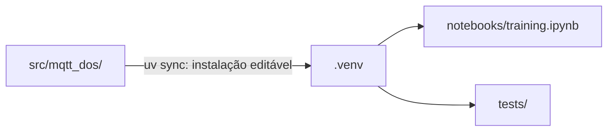

# 01-2. Pacote `mqtt_dos` e primeiro teste

## Objetivos desta aula

Ao final desta aula você vai entender:

- por que a lógica do treino mora num **pacote instalável** em `src/`, e não em células de notebook;
- como uma **dataclass congelada** vira a configuração central de um run, com validação na criação;
- como o **pytest** confere automaticamente que o código faz o que você espera.

E vai ter construído:

- o pacote `mqtt_dos`, instalado no ambiente do projeto;
- o `RunConfig`, com os defaults do protocolo do paper (seed 42, split 80/20, 30 trials, 5 folds, 7 modelos, 6 seletores);
- 8 testes passando.

**Vitória da aula:** `uv run pytest` mostra `8 passed`, e `RunConfig()` imprime o protocolo do paper.

## Onde estamos

Na [aula 01-1](01-1-ambiente-com-uv.md) o ambiente do projeto foi criado com `uv`: manifesto, lockfile e
`.python-version`. Agora entra o código: o pacote onde toda a lógica do treino vai morar. A aula 01-3 fecha o
ticket 01 com o ruff e o notebook.

### Relembrando

??? question "1. Qual comando adiciona uma biblioteca ao projeto e por que não `uv pip install`?"

    `uv add <pacote>`. Ele escreve no manifesto, atualiza o lockfile e instala. O `uv pip install` mexe só
    no `.venv`, e o próximo `uv sync` remove o pacote.

??? question "2. Por que a aula 01-1 apagou o `[build-system]`?"

    Porque ele mandava o flit empacotar um módulo `mqtt_under_attack` que não existia, e o `uv sync` falhava.
    Sem `[build-system]`, o `uv` instala só as dependências. Nesta aula um `[build-system]` novo volta.

## Antes de começar

O ambiente da aula 01-1 precisa estar funcionando:

```bash title="$ Execução no terminal (na pasta do projeto)"
uv lock --check
```

Nenhuma ferramenta nova: o pytest já está no grupo `dev`.

## Conceitos

### Pacote instalável (layout `src/`)

Um **[pacote](glossario.md#pacote)** é uma pasta com um `__init__.py` que o Python consegue importar
(`import mqtt_dos`). No **layout `src/`**, ele fica em `src/mqtt_dos/`, e os testes ficam fora, em `tests/`.

Para o Python achar o pacote, ele precisa estar **instalado** no ambiente. Um **build backend** (aqui o
`uv_build`, declarado no `[build-system]`) sabe empacotar a pasta, e o `uv sync` instala o projeto em modo
**editável**: o ambiente aponta para a sua pasta `src/`, então cada alteração no código vale na hora, sem
reinstalar.

Analogia: é a diferença entre um protocolo de laboratório escrito num caderno de rascunho (as células de
um notebook) e um procedimento operacional padrão arquivado, que todo experimento consulta pelo mesmo
nome.

O problema que resolve: com a lógica dentro dos notebooks, `04_pipeline` e `04_svm` divergiram (cada um
tinha a sua cópia do pré-processamento). Num pacote, o notebook, os testes e, mais tarde, a API importam
**a mesma função**. Por que `src/`: o pytest recomenda esse layout porque, sem ele, o Python importa o
pacote da pasta atual e esconde erros de instalação.



Fontes: [uv — The uv build backend](https://docs.astral.sh/uv/concepts/build-backend/) ("By default, a
single root module is expected at `src/<package_name>/__init__.py`");
[pytest — Good Integration Practices](https://docs.pytest.org/en/stable/explanation/goodpractices.html).

### Dataclass congelada

Uma **[dataclass](glossario.md#dataclass-congelada)** é uma classe em que você só lista os campos e o
Python gera o `__init__`, o `__repr__` (a impressão legível) e o `__eq__` (comparação). Com `frozen=True`,
nenhum campo pode ser alterado depois da criação: tentar levanta `FrozenInstanceError`.

Analogia: a ficha de um experimento registrada antes de rodar. Para testar outra condição, você preenche
uma ficha nova (`dataclasses.replace`) em vez de rasurar a antiga.

O problema que resolve: os notebooks antigos tinham `RANDOM_STATE`, `N_TRIALS` e caminhos espalhados em
variáveis globais, que qualquer célula podia mudar no meio da execução. Uma configuração congelada garante
que o run inteiro usou os mesmos parâmetros, e o `__post_init__` (chamado logo após o `__init__`) recusa
valores impossíveis já na criação.

Fonte: [Python — dataclasses](https://docs.python.org/3/library/dataclasses.html).

### Testes com pytest

Um **[teste](glossario.md#teste)** é uma função que executa um pedaço do código e afirma o resultado
esperado. O pytest encontra sozinho os arquivos `test_*.py` e as funções que começam com `test_`, roda
todas e mostra quais passaram. Ele usa o `assert` comum do Python. `pytest.raises` afirma que um erro
**deve** acontecer, e `@pytest.mark.parametrize` roda o mesmo teste com vários valores.

Analogia: o controle positivo e o negativo de um ensaio. Se o controle falha, você sabe que o problema
está no ensaio antes de olhar o resultado.

O problema que resolve: hoje a única forma de saber se o pipeline está certo é rodar o notebook inteiro e
olhar os números. Com testes, uma mudança que quebra algo aparece em segundos. É assim que a aula 03 vai
garantir que os gaps não voltem a vazar o rótulo.

Fontes: [pytest — How to write and report assertions](https://docs.pytest.org/en/stable/how-to/assert.html);
[pytest — How to parametrize](https://docs.pytest.org/en/stable/how-to/parametrize.html).

## Ponte teoria → projeto

O ticket [01](issues/01-scaffolding.md) pede o pacote `mqtt_dos` importável, expondo a configuração do run,
e `uv run pytest` passando. As decisões 7 (pacote `src/mqtt_dos/` com a lógica), 14 (protocolo do Optuna do
paper, configurável), 20 (`run_name` no `RunConfig`) e 15 (testes) do [log de decisões](decisions.md)
definem o que o `RunConfig` guarda. A decisão 35 mantém o nome do projeto `mqtt_under_attack` e chama o
módulo de `mqtt_dos`.

Para a sua missão, o `RunConfig` é a seção "Hyperparameter Optimization" do paper em forma de código: seed,
trials, folds, modelos e seletores num lugar só, com os valores do artigo como padrão.

## Mão na massa

### Passo 1 — Declarar o build backend

Voltamos com um `[build-system]`, agora apontando para o pacote novo. Acrescente no **topo** do
`pyproject.toml`:

```toml title="pyproject.toml (topo)" linenums="1"
[build-system]
requires = ["uv_build>=0.11.17,<0.12.0"]  # (1)!
build-backend = "uv_build"
```

1.  O `uv_build` é o build backend do próprio `uv`. O limite `<0.12.0` acompanha a versão do `uv` instalado
    (0.11.x): é o que o `uv init --lib` gera nesta versão. Sem o limite, uma versão futura do backend
    poderia mudar o comportamento do build sem aviso.

E logo abaixo do bloco `[project]` (antes de `[tool.ruff]`):

```toml title="pyproject.toml (depois de [project])" linenums="1"
[tool.uv.build-backend]
module-name = "mqtt_dos"  # (1)!

[tool.pytest.ini_options]
testpaths = ["tests"]  # (2)!
```

1.  Por padrão o backend procura `src/<nome do projeto>/`, ou seja, `src/mqtt_under_attack/`. Mantemos o
    nome do projeto e escolhemos um módulo mais curto para os `import`s.
2.  Diz ao pytest para procurar testes só em `tests/`, sem varrer os notebooks e scripts antigos.

### Passo 2 — Criar o pacote

Crie a pasta `src/mqtt_dos/` e, dentro dela, o `__init__.py`. Ele é o que torna a pasta importável e diz o
que o pacote oferece para fora.

```python title="src/mqtt_dos/__init__.py" linenums="1"
"""Esquema de treino unificado para detecção de DoS em MQTT."""

from mqtt_dos.config import RunConfig  # (1)!

__all__ = ["RunConfig"]  # (2)!
```

1.  Reexporta o `RunConfig`: quem usa o pacote escreve `from mqtt_dos import RunConfig`, sem precisar saber
    em qual arquivo ele mora.
2.  Lista os nomes públicos do pacote. Ferramentas como o ruff e o editor usam essa lista.

### Passo 3 — Constantes do projeto

Crie `src/mqtt_dos/config.py`. Começamos pelos caminhos do projeto.

```python title="src/mqtt_dos/config.py" linenums="1"
"""Configuração central de um run de treino."""

from dataclasses import dataclass, field
from pathlib import Path

PROJECT_ROOT = Path(__file__).resolve().parents[2]  # (1)!
RAW_DATA_PATH = PROJECT_ROOT / "data" / "raw" / "MQTT Under Attack Dataset" / "DoS.csv"
OUTPUTS_DIR = PROJECT_ROOT / "outputs"  # (2)!
```

1.  `__file__` é o caminho deste arquivo. `parents[0]` é `src/mqtt_dos`, `parents[1]` é `src` e `parents[2]`
    é a raiz do projeto. Assim o caminho do dataset funciona de qualquer pasta, inclusive de dentro de
    `notebooks/`. Os notebooks antigos usavam `'../data/...'`, que quebra se você rodar de outro lugar.
    Isso só funciona porque a instalação é editável: o pacote continua morando na sua pasta `src/`.
2.  Todos os artefatos de um run novo vão para `outputs/` (decisão 9), longe dos artefatos que a API usa hoje.

Logo abaixo, os nomes dos sete modelos e dos seis seletores do paper:

```python title="src/mqtt_dos/config.py (continuação)" linenums="10"
MODEL_NAMES = (  # (1)!
    "LDA",
    "QDA",
    "GaussianNB",
    "DecisionTree",
    "RandomForest",
    "GradientBoosting",
    "SVM",
)
SELECTOR_NAMES = (
    "LowVariance",
    "ANOVA",
    "MutualInformation",
    "Lasso",
    "LinearSVC",
    "ExtraTrees",
)
```

1.  Tuplas, e não listas, porque tuplas não podem ser alteradas: combinam com uma configuração congelada.
    Um nome por linha é o formato que o ruff (aula 01-3) usa para listas longas e deixa cada modelo
    adicionado ou removido aparecer como uma linha no `git diff`.

### Passo 4 — O `RunConfig`

Agora a dataclass. Cada campo tem o valor do protocolo do paper como padrão.

```python title="src/mqtt_dos/config.py (continuação)" linenums="29"
@dataclass(frozen=True)  # (1)!
class RunConfig:
    """Parâmetros de um run; os defaults seguem o protocolo do paper WPMC."""

    run_name: str = "paper_protocol"
    random_state: int = 42
    test_size: float = 0.2
    n_trials: int = 30
    cv_folds: int = 5
    top_k: int = 15
    tune_subsample: dict[str, int] = field(default_factory=lambda: {"SVM": 15_000})  # (2)!
    models: tuple[str, ...] = MODEL_NAMES
    selectors: tuple[str, ...] = SELECTOR_NAMES
```

1.  `frozen=True` impede que um campo seja alterado depois da criação.
2.  Um dicionário não pode ser valor padrão direto: seria o mesmo objeto compartilhado por todas as
    instâncias, e a dataclass recusa (veja Erros comuns). O `default_factory` chama a função a cada
    `RunConfig()` e cria um dicionário novo. `15_000` é só `15000` com separador de milhar, para ler melhor.

??? question "Pare e pense: o que você espera ver ao rodar `c = RunConfig(); c.n_trials = 1`?"

    Um erro: `dataclasses.FrozenInstanceError: cannot assign to field 'n_trials'`. Para um run com menos
    trials, crie outra configuração: `replace(c, n_trials=1)`.

### Passo 5 — Validar na criação

O `__post_init__` roda logo depois do `__init__` gerado. É o lugar para recusar valores que não fazem
sentido, antes que um run de horas comece com eles. Continue dentro da classe:

```python title="src/mqtt_dos/config.py (continuação)" linenums="43"
    def __post_init__(self) -> None:
        if not 0 < self.test_size < 1:  # (1)!
            raise ValueError(f"test_size deve estar entre 0 e 1, recebido {self.test_size}")
        if self.cv_folds < 2:  # (2)!
            raise ValueError(f"cv_folds deve ser pelo menos 2, recebido {self.cv_folds}")
        unknown_models = set(self.models) - set(MODEL_NAMES)  # (3)!
        if unknown_models:
            raise ValueError(f"modelos desconhecidos: {sorted(unknown_models)}")
        unknown_selectors = set(self.selectors) - set(SELECTOR_NAMES)
        if unknown_selectors:
            raise ValueError(f"seletores desconhecidos: {sorted(unknown_selectors)}")
```

1.  Um split com `test_size=0` ou `1` deixaria treino ou teste vazio.
2.  Validação cruzada precisa de pelo menos 2 folds.
3.  A diferença de conjuntos mostra os nomes pedidos que não existem. Um erro de digitação como `"RandomForrest"`
    para o run na hora, em vez de sumir silenciosamente do grid.

### Passo 6 — Onde ficam os artefatos

Por último, uma propriedade: um valor calculado a partir dos campos, lido como se fosse um campo.

```python title="src/mqtt_dos/config.py (continuação)" linenums="55"
    @property
    def output_dir(self) -> Path:
        return OUTPUTS_DIR / self.run_name
```

### Passo 7 — Instalar o pacote

Agora o `uv sync` encontra um `[build-system]` e instala o projeto no ambiente.

```bash title="$ Execução no terminal (na pasta do projeto)"
uv sync
```

```text title="Saída esperada (o caminho é o da sua máquina)"
      Built mqtt-under-attack @ file:///.../mqtt_under_attack
Prepared 1 package in 10ms
Installed 1 package in 0.71ms
 + mqtt-under-attack==0.0.1 (from file:///.../mqtt_under_attack)
```

**O que aconteceu:** o `uv_build` empacotou `src/mqtt_dos/` e o `uv` o instalou em modo editável. A partir
de agora, `import mqtt_dos` funciona em qualquer comando `uv run`.

```bash title="$ Execução no terminal (na pasta do projeto)"
uv run python -c "from mqtt_dos import RunConfig; print(RunConfig())"
```

```text title="Saída esperada"
RunConfig(run_name='paper_protocol', random_state=42, test_size=0.2, n_trials=30, cv_folds=5, top_k=15, tune_subsample={'SVM': 15000}, models=('LDA', 'QDA', 'GaussianNB', 'DecisionTree', 'RandomForest', 'GradientBoosting', 'SVM'), selectors=('LowVariance', 'ANOVA', 'MutualInformation', 'Lasso', 'LinearSVC', 'ExtraTrees'))
```

**O que aconteceu:** você não escreveu nenhum `__repr__`, mas a dataclass gerou um que mostra cada campo.
É o protocolo do paper inteiro numa linha.

## Testando

Crie `tests/test_config.py`. Cada teste afirma um comportamento do `RunConfig`, do ponto de vista de quem
o usa.

```python title="tests/test_config.py" linenums="1"
from dataclasses import FrozenInstanceError, replace

import pytest

from mqtt_dos import RunConfig
from mqtt_dos.config import OUTPUTS_DIR


def test_defaults_follow_paper_protocol():  # (1)!
    config = RunConfig()

    assert config.random_state == 42
    assert config.test_size == 0.2
    assert config.n_trials == 30
```

1.  O nome começa com `test_`, então o pytest o encontra. O nome diz o que se espera, em inglês (decisão 6):
    quando falhar, o relatório já explica o que quebrou.

```python title="tests/test_config.py (continuação)" linenums="15"
    assert config.cv_folds == 5
    assert len(config.models) == 7
    assert len(config.selectors) == 6


def test_output_dir_uses_run_name():
    config = RunConfig(run_name="smoke")

    assert config.output_dir == OUTPUTS_DIR / "smoke"


def test_config_is_frozen():
    config = RunConfig()

    with pytest.raises(FrozenInstanceError):  # (1)!
        config.n_trials = 1
```

1.  O teste passa só se o bloco dentro do `with` **levantar** esse erro. Se a atribuição funcionasse, o
    teste falharia com `DID NOT RAISE`.

```python title="tests/test_config.py (continuação)" linenums="31"


def test_replace_creates_quick_config():
    quick = replace(RunConfig(), run_name="smoke", n_trials=2, cv_folds=2)

    assert quick.n_trials == 2
    assert RunConfig().n_trials == 30  # (1)!


@pytest.mark.parametrize("test_size", [0, 1, 1.5])  # (2)!
def test_invalid_test_size_is_rejected(test_size):
    with pytest.raises(ValueError, match="test_size"):  # (3)!
        RunConfig(test_size=test_size)
```

1.  Confere que o `replace` criou uma configuração nova sem tocar no padrão.
2.  O mesmo teste roda três vezes, uma por valor. Cada execução aparece separada no relatório.
3.  `match` confere que a mensagem do erro menciona `test_size`, para garantir que falhou pelo motivo certo.

```python title="tests/test_config.py (continuação)" linenums="44"


def test_unknown_model_is_rejected():
    with pytest.raises(ValueError, match="XGBoost"):
        RunConfig(models=("LDA", "XGBoost"))
```

??? question "Pare e pense: são 6 funções de teste. Quantos testes o pytest vai contar?"

    8. O teste parametrizado vale por três (`[0]`, `[1]` e `[1.5]`).

```bash title="$ Execução no terminal (na pasta do projeto)"
uv run pytest
```

```text title="Saída esperada (a linha rootdir mostra o caminho da sua máquina)"
============================= test session starts ==============================
platform linux -- Python 3.13.13, pytest-9.1.1, pluggy-1.6.0
rootdir: ...
configfile: pyproject.toml
testpaths: tests
plugins: platformdirs-4.13.0
collected 8 items

tests/test_config.py ........                                            [100%]

============================== 8 passed in 0.01s ===============================
```

**Como ler a saída do pytest:** o cabeçalho diz qual Python e qual configuração foram usados
(`configfile: pyproject.toml`, `testpaths: tests`, do passo 1). `collected 8 items` é quantos testes ele
achou. Cada ponto depois do nome do arquivo é um teste que passou; uma falha aparece como `F` e um erro
inesperado como `E`. A linha final resume tudo. Com `-v`, cada teste aparece numa linha com o nome:

```bash title="$ Execução no terminal (na pasta do projeto)"
uv run pytest tests/test_config.py -v
```

```text title="Saída esperada (trecho)"
tests/test_config.py::test_defaults_follow_paper_protocol PASSED         [ 12%]
tests/test_config.py::test_output_dir_uses_run_name PASSED               [ 25%]
tests/test_config.py::test_config_is_frozen PASSED                       [ 37%]
tests/test_config.py::test_replace_creates_quick_config PASSED           [ 50%]
tests/test_config.py::test_invalid_test_size_is_rejected[0] PASSED       [ 62%]
tests/test_config.py::test_invalid_test_size_is_rejected[1] PASSED       [ 75%]
tests/test_config.py::test_invalid_test_size_is_rejected[1.5] PASSED     [ 87%]
tests/test_config.py::test_unknown_model_is_rejected PASSED              [100%]

============================== 8 passed in 0.02s ===============================
```

## Erros comuns

**1. O backend procura a pasta com o nome do projeto.** Sem o `[tool.uv.build-backend]` do passo 1:

```text
  × Failed to build `mqtt-under-attack @ file:///.../mqtt_under_attack`
  ╰─▶ Expected a Python module at: src/mqtt_under_attack/__init__.py
```

Causa: por padrão o módulo deve ter o nome do projeto. Correção: `module-name = "mqtt_dos"`.

**2. Dicionário como valor padrão direto** (`tune_subsample: dict[str, int] = {"SVM": 15000}`):

```text
ValueError: mutable default <class 'dict'> for field tune_subsample is not allowed: use default_factory
```

Causa: o mesmo dicionário seria compartilhado por todas as configurações. Correção: `field(default_factory=...)`, como no passo 4.

**3. Teste que o pytest não encontra.** Um arquivo que não começa com `test_` ou uma função que não começa
com `test_` é ignorado em silêncio:

```text
collected 0 items

============================ no tests ran in 0.01s =============================
```

Correção: renomeie arquivo e função com o prefixo `test_`.

## Código completo desta aula

??? example "Arquivo completo: src/mqtt_dos/__init__.py"

    ```python
    """Esquema de treino unificado para detecção de DoS em MQTT."""

    from mqtt_dos.config import RunConfig

    __all__ = ["RunConfig"]
    ```

??? example "Arquivo completo: src/mqtt_dos/config.py"

    ```python
    --8<-- "src/mqtt_dos/config.py"
    ```

??? example "Arquivo completo: tests/test_config.py"

    ```python
    --8<-- "tests/test_config.py"
    ```

??? example "Trecho novo do pyproject.toml"

    ```toml
    [build-system]
    requires = ["uv_build>=0.11.17,<0.12.0"]
    build-backend = "uv_build"

    # ... [project] da aula 01-1 ...

    [tool.uv.build-backend]
    module-name = "mqtt_dos"

    [tool.pytest.ini_options]
    testpaths = ["tests"]
    ```

## Exercícios

1. **Trials impossíveis.** Hoje `RunConfig(n_trials=0)` é aceito, e um estudo Optuna com zero trials não
   produz modelo. Faça o `__post_init__` recusar `n_trials < 1`. Está pronto quando este teste passar:

    ```python title="tests/test_exercicio_01_2.py"
    import pytest

    from mqtt_dos import RunConfig


    @pytest.mark.parametrize("n_trials", [0, -5])
    def test_n_trials_must_be_positive(n_trials):
        with pytest.raises(ValueError, match="n_trials"):
            RunConfig(n_trials=n_trials)
    ```

    ```bash title="$ Execução no terminal (na pasta do projeto)"
    uv run pytest tests/test_exercicio_01_2.py
    ```

    Antes da solução, o pytest mostra:

    ```text title="Saída esperada (antes)"
    E       Failed: DID NOT RAISE ValueError
    ...
    FAILED tests/test_exercicio_01_2.py::test_n_trials_must_be_positive[0] - Fail...
    FAILED tests/test_exercicio_01_2.py::test_n_trials_must_be_positive[-5] - Fai...
    ============================== 2 failed in 0.02s ===============================
    ```

??? tip "Solução"

    No `__post_init__`, antes da checagem de `cv_folds`:

    ```python title="src/mqtt_dos/config.py"
            if self.n_trials < 1:
                raise ValueError(f"n_trials deve ser pelo menos 1, recebido {self.n_trials}")
    ```

    ```text title="Saída esperada (depois)"
    ============================== 2 passed in 0.01s ===============================
    ```

2. **Atalho para a rodada rápida.** A aula 07 vai rodar o grid inteiro com poucos trials para testar.
   Crie um método de classe `RunConfig.smoke()` que devolve `run_name="smoke"`, `n_trials=2` e `cv_folds=2`,
   mantendo o resto. Acrescente ao arquivo do exercício:

    ```python title="tests/test_exercicio_01_2.py (acrescentar)"
    def test_smoke_config():
        smoke = RunConfig.smoke()

        assert smoke.run_name == "smoke"
        assert smoke.n_trials == 2
        assert smoke.cv_folds == 2
        assert smoke.models == RunConfig().models
    ```

    Antes da solução: `FAILED tests/test_exercicio_01_2.py::test_smoke_config - AttributeError: type...`.

??? tip "Solução"

    Dentro da classe, antes do `output_dir`:

    ```python title="src/mqtt_dos/config.py"
        @classmethod
        def smoke(cls) -> "RunConfig":
            return cls(run_name="smoke", n_trials=2, cv_folds=2)
    ```

    `@classmethod` recebe a própria classe (`cls`) em vez de uma instância, então cria a configuração sem
    precisar de uma existente. Depois: `3 passed`.

3. **Rodar só parte dos testes.** Num projeto com centenas de testes, você roda só o que está mexendo.
   Rode apenas `test_config_is_frozen` e, depois, só os testes cujo nome contém `invalid`. Está pronto quando
   o primeiro comando coletar 1 item e o segundo selecionar 3.

??? tip "Solução"

    ```bash title="$ Execução no terminal (na pasta do projeto)"
    uv run pytest "tests/test_config.py::test_config_is_frozen" -v
    uv run pytest -k "invalid" -v
    ```

    ```text title="Saída esperada (trecho, com os exercícios 1 e 2 feitos)"
    collecting ... collected 1 item

    tests/test_config.py::test_config_is_frozen PASSED                       [100%]
    ...
    collecting ... collected 11 items / 8 deselected / 3 selected
    ...
    ======================= 3 passed, 8 deselected in 0.01s ========================
    ```

## Quiz de fixação

??? question "1. Com suas palavras: por que `PROJECT_ROOT` usa `Path(__file__).resolve().parents[2]` em vez de `Path('..')`?"

    `Path('..')` depende da pasta de onde você roda o comando: de `notebooks/` aponta para a raiz, de outra
    pasta aponta para outro lugar. `__file__` é sempre o caminho do `config.py`, então subir dois níveis a
    partir dele sempre chega à raiz do projeto, e funciona porque a instalação editável mantém o arquivo na
    sua pasta `src/`.

??? question "2. Você quer comparar o protocolo do paper com um run de 10 trials. Como cria a segunda configuração sem alterar a primeira?"

    `replace(RunConfig(), run_name="trials_10", n_trials=10)`. O `replace` chama o `__init__` de novo, então
    o `__post_init__` também valida a configuração nova. Atribuir `config.n_trials = 10` levantaria
    `FrozenInstanceError`.

**3. O que acontece com `RunConfig(selectors=("LowVariance", "Pearson"))`?**

- a) O run ignora o seletor desconhecido
- b) A criação levanta um `ValueError`
- c) O Pearson é aceito como sinônimo

??? question "Resposta da 3"

    **b)**: `ValueError: seletores desconhecidos: ['Pearson']`. O a) é justamente o que a validação evita (um
    seletor sumir do grid sem aviso); o c) está errado porque Pearson não é um dos seis seletores do paper
    (decisão 13).

??? question "4. (Revisão da 01-1) Depois de criar o pacote, o `uv sync` instalou um pacote a mais. Qual, e por que ele não apareceu na aula 01-1?"

    O próprio `mqtt-under-attack`. Na 01-1 não havia `[build-system]`, e sem ele o `uv` instala só as
    dependências, nunca o projeto.

## Commit

```bash title="$ Execução no terminal (na pasta do projeto)"
git add pyproject.toml uv.lock src/ tests/
git commit -m "feat: pacote mqtt_dos com RunConfig e primeiros testes"
```

Não inclua `tests/test_exercicio_01_2.py` se quiser manter o repositório só com o código do projeto; se
fizer os exercícios e gostar das soluções, leve-as para `config.py` e `test_config.py`.

## Resumo

- A lógica do treino mora no **pacote** `src/mqtt_dos/`, instalado em modo editável pelo `uv sync` graças
  ao `[build-system]` com `uv_build`.
- O `RunConfig` é uma **dataclass congelada**: defaults do paper, validação no `__post_init__`, variações
  com `replace`.
- O **pytest** acha `test_*.py` e `test_*`; `assert`, `pytest.raises` e `parametrize` cobrem quase tudo.

## Fonte principal

- [Python — dataclasses](https://docs.python.org/3/library/dataclasses.html): leia `frozen`, "Mutable
  default values", `__post_init__` e `replace`.

## Para saber mais

- [uv — The uv build backend](https://docs.astral.sh/uv/concepts/build-backend/)
- [pytest — Good Integration Practices](https://docs.pytest.org/en/stable/explanation/goodpractices.html)
- [pytest — How to write and report assertions](https://docs.pytest.org/en/stable/how-to/assert.html)
- [pytest — How to parametrize](https://docs.pytest.org/en/stable/how-to/parametrize.html)

!!! question "Ficou com dúvida?"

    O agente é o seu professor neste curso. Pergunte qualquer coisa que não ficou clara, colando a
    mensagem de erro exata e o que você já tentou.

**Próxima aula:** [01-3. Ruff e notebook ligado ao ambiente](01-3-ruff-e-notebook.md)
