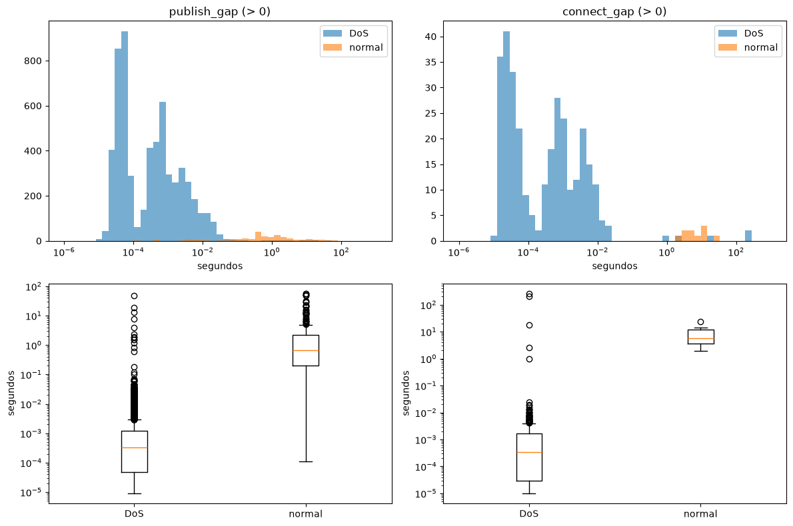

# 03. Gaps de publish e connect sem vazamento

## Objetivos desta aula

Ao final desta aula você vai entender:

- o que é uma **feature de gap** e por que ela separa um ataque de inundação do tráfego normal;
- o que é **vazamento de rótulo**, por que o cálculo antigo dos gaps tinha esse defeito e qual foi o efeito
  real dele neste dataset;
- como o **alinhamento por índice** do pandas evita que valores calculados numa ordem caiam nas linhas
  erradas.

E vai ter construído:

- o módulo `mqtt_dos.features`, com `message_gap` e `add_gaps`;
- 5 testes, incluindo um que trava o vazamento ("o resultado não muda se o rótulo mudar");
- a seção 2 do notebook: a tabela com as 22 candidatas, a distribuição dos gaps por classe e a comparação
  com o cálculo antigo.

**Vitória da aula:** `drop_unused_columns(add_gaps(raw)).shape` devolve `(94625, 23)`, ou seja, as 22
features candidatas do paper mais o rótulo, e o teste
`test_gaps_do_not_depend_on_the_label` passa.

## Onde estamos

Na [aula 02](02-carga-e-limpeza.md) você escreveu `load_raw` e `drop_unused_columns` e viu que os nulos são
estruturais. Esta aula acrescenta as duas features temporais do paper. A aula 04 faz o split e monta o
primeiro Pipeline de inferência.

### Relembrando

??? question "1. `frame.time_epoch` sai na limpeza. Em que ordem o pipeline chama `load_raw`, `drop_unused_columns` e a função de gaps?"

    `load_raw → add_gaps → drop_unused_columns`. Os gaps precisam do `frame.time_epoch`, então são
    calculados sobre a tabela bruta, antes que a limpeza o descarte (decisão 41).

??? question "2. Por que `drop_unused_columns` devolve um DataFrame novo em vez de alterar o original?"

    Para que a tabela bruta do notebook continue inteira. Se a função alterasse o original, uma segunda
    execução da célula, ou outra seção que use `raw`, encontraria colunas faltando.

## Antes de começar

A aula 02 precisa estar feita, com os testes verdes:

```bash title="$ Execução no terminal (na pasta do projeto)"
uv run pytest
```

```text title="Saída esperada (o tempo varia)"
13 passed in 2.35s
```

Nenhuma ferramenta nova.

## Conceitos

### Feature de gap

Uma **[feature de gap](glossario.md#feature-de-gap)** mede o tempo desde a última mensagem do mesmo tipo.
O `publish_gap` de um PUBLISH é quantos segundos se passaram desde o PUBLISH anterior; o `connect_gap` faz o
mesmo para CONNECT. Os pacotes de outros tipos, e a primeira ocorrência de cada tipo, ficam com 0.

O cálculo é uma **diferença entre linhas consecutivas**: ordenando os horários dos PUBLISH, `Series.diff()`
subtrai de cada valor o anterior. O primeiro não tem anterior e vira `NaN`, que preenchemos com 0.

Analogia: o intervalo entre batidas do coração. Um ataque de inundação é uma taquicardia: as mensagens chegam
com intervalos de micro a milissegundos, enquanto o tráfego normal tem intervalos de décimos de segundo a
segundos. É exatamente o que o gráfico da seção 2 vai mostrar.

Uma propriedade importante para a implantação: o gap é **causal**, porque depende só de pacotes que já
passaram. Um broker ou um sensor no Raspberry Pi consegue calculá-lo em tempo real, pacote a pacote.

Fonte: [pandas — Series.diff](https://pandas.pydata.org/docs/reference/api/pandas.Series.diff.html)
("calculates the difference of a Series element compared with another element in the Series (default is
element in previous row)").

### Vazamento de rótulo

**[Vazamento](glossario.md#vazamento)** é usar, para construir o modelo, informação que não existe na hora da
predição. O resultado é uma estimativa otimista no teste e um desempenho pior em produção.

O cálculo antigo dos gaps tinha um vazamento **de rótulo**: ele separava os pacotes por `type` e calculava os
gaps dentro de cada classe. O gap de um pacote DoS era o tempo desde o PUBLISH DoS anterior, pulando os
PUBLISH normais no meio. Na rede real não há rótulo, só o fluxo de pacotes, então essa feature **não pode ser
calculada em produção**. É o mesmo tipo de erro de usar a resposta para montar a pergunta.

O que a correção muda, medido neste dataset:

| | antigo (por `type`) | novo (fluxo inteiro) |
|---|---|---|
| gaps de PUBLISH diferentes de 0 | 6150 | 6151 |
| maior `publish_gap` no DoS | 248,2 s | 48,3 s |
| maior `publish_gap` no normal | 108,8 s | 57,2 s |
| acurácia de uma árvore treinada **só** com os dois gaps | 0,5874 | 0,5874 |

A comparação foi feita reproduzindo o algoritmo do `04_pipeline.ipynb` (o resultado bate valor a valor com o
dele). Sendo honesto: **neste dataset o efeito numérico é pequeno**. Os dois tráfegos se sobrepõem no tempo e
quase todos os PUBLISH são DoS, então o agrupamento muda poucos valores, em geral os maiores. A correção vale
pelo método: a feature agora é a mesma no treino e em produção, e um teste garante que continue assim.

Analogia: corrigir um protocolo que usava o resultado do exame para separar as amostras. Mesmo que neste
lote os números quase não mudem, o protocolo antigo não pode ser repetido num paciente novo.

Fonte: [scikit-learn — Common pitfalls and recommended practices](https://scikit-learn.org/stable/common_pitfalls.html)
("Data leakage occurs when information that would not be available at prediction time is used when building
the model").

### Alinhamento por índice

Toda `Series` do pandas tem um **[índice](glossario.md#alinhamento-por-indice)**: um rótulo por linha. Quando
você atribui uma `Series` a uma coluna, ou soma duas `Series`, o pandas casa os valores **pelo rótulo**, não
pela posição. O `sort_values` reordena as linhas, mas cada valor leva o seu rótulo junto. O `reindex` devolve
os valores na ordem de outro índice e preenche com `fill_value` os rótulos que não existiam, como as linhas
que não são PUBLISH.

Analogia: provas corrigidas fora de ordem. Se cada nota está presa ao nome do aluno, a pilha pode ser
embaralhada à vontade; se a nota só tem a posição na pilha, embaralhar estraga tudo.

O problema que resolve: o código antigo ordenava uma cópia por tempo e devolvia os gaps com `.values`, ou seja,
**por posição**. Isso só dá certo porque o CSV bruto já vem ordenado por `frame.time_epoch`. Com qualquer outra
ordem (um CSV de outra captura, uma amostra embaralhada), os gaps cairiam nas linhas erradas, sem nenhum erro.

Fontes: [pandas — Intro to data structures](https://pandas.pydata.org/docs/user_guide/dsintro.html)
("operations between Series automatically align the data based on label");
[pandas — Series.reindex](https://pandas.pydata.org/docs/reference/api/pandas.Series.reindex.html);
[pandas — Series.sort_values](https://pandas.pydata.org/docs/reference/api/pandas.Series.sort_values.html)
("'mergesort' and 'stable' are the only stable algorithms").

## Ponte teoria → projeto

O ticket [03](issues/03-gaps-sem-vazamento.md) pede os gaps no fluxo inteiro, sem usar o rótulo, preservando
a ordem e o índice, com um teste que trava o vazamento e os gráficos por classe. A decisão 2 do
[log de decisões](decisions.md) corrigiu o cálculo, e a história de usuário 3 da
[especificação](issues/0000-spec-treino-unificado.md) pede que os gaps não dependam do rótulo.

Para a sua missão: as duas features que o paper acrescenta ao dataset agora são reproduzíveis em produção,
e a seção 2 do notebook gera, com números reais, a comparação antigo × novo que um revisor pode pedir.

## Mão na massa

### Passo 1 — Constantes do módulo

Crie `src/mqtt_dos/features.py`:

```python title="src/mqtt_dos/features.py" linenums="1"
"""Features temporais: gaps entre mensagens PUBLISH e entre mensagens CONNECT."""

import pandas as pd

TIME_COLUMN = "frame.time_epoch"
MSGTYPE_COLUMN = "mqtt.msgtype"
CONNECT = 1  # (1)!
PUBLISH = 3
```

1.  Os códigos de tipo de mensagem do MQTT: 1 é CONNECT, 3 é PUBLISH. Nomear os números faz o código dizer
    "PUBLISH", e não um `3` solto que só quem conhece o protocolo entende.

### Passo 2 — O gap de um tipo de mensagem

```python title="src/mqtt_dos/features.py (continuação)" linenums="11"
def message_gap(df: pd.DataFrame, msgtype: int) -> pd.Series:
    """Segundos desde a mensagem anterior do mesmo tipo, no fluxo inteiro; 0 nas demais linhas."""
    is_type = df[MSGTYPE_COLUMN] == msgtype  # (1)!
    times = df.loc[is_type, TIME_COLUMN].sort_values(kind="stable")  # (2)!
    gaps = times.diff().fillna(0.0)  # (3)!
    return gaps.reindex(df.index, fill_value=0.0)  # (4)!
```

1.  `True` nas linhas do tipo pedido. Comparar um `NaN` (pacote que não é MQTT) com 3 dá `False`, então
    esses pacotes ficam de fora sem precisar de `fillna`. Repare: **nenhuma linha usa `type`**.
2.  Os horários dos PUBLISH (ou CONNECT) do fluxo inteiro, em ordem de tempo. Cada valor mantém o rótulo da
    sua linha original. `kind="stable"` mantém a ordem original entre pacotes com o mesmo horário, então o
    resultado não muda de uma execução para outra.
3.  A diferença para o anterior. O primeiro vira `NaN` e é preenchido com 0, como no paper.
4.  Volta para a ordem e o índice de `df`, **pelo rótulo**, e põe 0 nas linhas de outros tipos. É aqui que
    o alinhamento por índice dispensa o CSV estar ordenado.

??? question "Pare e pense: se o CSV viesse embaralhado, o código antigo (ordenar e devolver com `.values`) daria erro?"

    Não, e é isso que torna o defeito perigoso: ele daria valores errados **em silêncio**. Você vai ver o
    teste que pega isso na seção Testando, e o efeito real em Erros comuns.

### Passo 3 — Acrescentar as duas colunas

```python title="src/mqtt_dos/features.py (continuação)" linenums="19"
def add_gaps(df: pd.DataFrame) -> pd.DataFrame:
    """Acrescenta publish_gap e connect_gap sem usar o rótulo."""
    with_gaps = df.copy()  # (1)!
    with_gaps["publish_gap"] = message_gap(df, PUBLISH)
    with_gaps["connect_gap"] = message_gap(df, CONNECT)
    return with_gaps
```

1.  A mesma regra da aula 02: a função devolve uma tabela nova e deixa `raw` intacta.

### Passo 4 — A seção 2 do notebook

Reinicie o kernel (o módulo `features` é novo). Troque o texto da célula `## 2. Gaps de publish e connect` por:

```markdown title="notebooks/training.ipynb — célula Markdown da seção 2"
## 2. Gaps de publish e connect

Duas features temporais: segundos desde o PUBLISH anterior e desde o CONNECT anterior, no fluxo inteiro de pacotes, em ordem de tempo. Elas são calculadas sobre a tabela bruta, porque a limpeza remove o `frame.time_epoch`, e não usam o rótulo.
```

Logo abaixo:

```python title="notebooks/training.ipynb — tabela com gaps" linenums="1"
from mqtt_dos.features import add_gaps

data = drop_unused_columns(add_gaps(raw))  # (1)!
data.shape
```

1.  A partir daqui o notebook usa `data`: as 22 candidatas mais `type`. O `clean` da seção 1 fica só como
    registro da limpeza.

```text title="Saída esperada"
(94625, 23)
```

Quantos gaps não nulos há em cada classe:

```python title="notebooks/training.ipynb — gaps não nulos por classe" linenums="1"
gap_columns = ["publish_gap", "connect_gap"]
data[gap_columns].ne(0).groupby(data[TARGET_COLUMN]).sum()
```

```text title="Saída esperada"
        publish_gap  connect_gap
type                            
DoS            5918          312
normal          233           10
```

??? question "Pare e pense: antes do gráfico, onde você espera os gaps do DoS em relação aos do normal, numa escala de segundos?"

    Muito menores: a inundação manda mensagens com intervalos de dezenas de microssegundos a milissegundos,
    e o tráfego normal com intervalos de décimos de segundo a segundos.

A distribuição, em escala logarítmica (os gaps vão de 10⁻⁵ a 10² segundos):

```python title="notebooks/training.ipynb — distribuição dos gaps" linenums="1"
import matplotlib.pyplot as plt
import numpy as np

fig, axes = plt.subplots(2, 2, figsize=(12, 8))
bins = np.logspace(-6, 3, 50)  # (1)!
for col, column in enumerate(gap_columns):
    nonzero = data[data[column] > 0]  # (2)!
    for label, group in nonzero.groupby(TARGET_COLUMN):
        axes[0, col].hist(group[column], bins=bins, alpha=0.6, label=label)
    axes[0, col].set(xscale="log", title=f"{column} (> 0)", xlabel="segundos")
    axes[0, col].legend()
    groups = [group[column] for _, group in nonzero.groupby(TARGET_COLUMN)]
    axes[1, col].boxplot(groups, tick_labels=sorted(nonzero[TARGET_COLUMN].unique()))
    axes[1, col].set(yscale="log", ylabel="segundos")
plt.tight_layout()
```

1.  Intervalos igualmente espaçados em escala log, de 1 µs a 1000 s. Com intervalos lineares, todo o DoS
    cairia na primeira barra.
2.  Só os gaps maiores que 0: os zeros (pacotes de outros tipos e primeiras ocorrências) não são intervalos
    e esmagariam o gráfico.



**O que aconteceu:** os gaps do DoS se concentram entre 10⁻⁵ e 10⁻² segundos; os do normal, entre 10⁻¹ e 10¹.
Mesmo calculados no fluxo inteiro, sem o rótulo, os gaps continuam separando as classes.

Por último, a comparação com o cálculo antigo. Uma célula Markdown:

```markdown title="notebooks/training.ipynb — célula Markdown"
**Comparação com o código antigo.** O `04_pipeline.ipynb` calculava os gaps separadamente para cada valor de `type`. Isso equivale a aplicar `add_gaps` a cada classe isolada:
```

```python title="notebooks/training.ipynb — antigo × novo" linenums="1"
import pandas as pd

by_label = pd.concat([add_gaps(group) for _, group in raw.groupby(TARGET_COLUMN)])  # (1)!
by_label = by_label.loc[raw.index]

pd.DataFrame(
    {
        "antigo (por type)": by_label.groupby(TARGET_COLUMN)["publish_gap"].max(),
        "novo (fluxo inteiro)": data.groupby(TARGET_COLUMN)["publish_gap"].max(),
    }
)
```

1.  Aplicar `add_gaps` a cada classe separada reproduz o cálculo antigo: os PUBLISH de uma classe "não veem"
    os da outra. O `pd.concat` junta as partes e o `.loc[raw.index]` devolve a ordem original. É o vazamento,
    construído de propósito, só para comparação.

```text title="Saída esperada"
        antigo (por type)  novo (fluxo inteiro)
type                                           
DoS            248.223048             48.269069
normal         108.823121             57.168259
```

**O que aconteceu:** o maior intervalo "visto" pelo DoS caiu de 248 para 48 segundos. No cálculo antigo, um
PUBLISH DoS isolado ignorava os PUBLISH normais que vieram no meio.

## Testando

Crie `tests/test_features.py`. O fluxo sintético tem seis pacotes, com horários escolhidos para que as contas
possam ser feitas de cabeça:

```python title="tests/test_features.py" linenums="1"
import pandas as pd
from pandas.testing import assert_frame_equal

from mqtt_dos.features import add_gaps

GAP_COLUMNS = ["publish_gap", "connect_gap"]


def make_stream():
    return pd.DataFrame(
        {
            "frame.time_epoch": [0.0, 1.0, 1.5, 4.0, 4.5, 10.0],
            "mqtt.msgtype": [1.0, 3.0, None, 3.0, 1.0, 3.0],  # (1)!
            "type": ["normal", "DoS", "normal", "normal", "DoS", "DoS"],
        }
    )
```

1.  CONNECT em 0 e 4,5; PUBLISH em 1, 4 e 10; um pacote não MQTT em 1,5. Os rótulos estão misturados de
    propósito: um PUBLISH normal (em 4) fica entre dois DoS.

```python title="tests/test_features.py (continuação)" linenums="19"
def test_publish_gap_is_time_since_previous_publish():
    gaps = add_gaps(make_stream())

    assert gaps["publish_gap"].tolist() == [0.0, 0.0, 0.0, 3.0, 0.0, 6.0]  # (1)!


def test_connect_gap_is_time_since_previous_connect():
    gaps = add_gaps(make_stream())

    assert gaps["connect_gap"].tolist() == [0.0, 0.0, 0.0, 0.0, 4.5, 0.0]
```

1.  PUBLISH em 1 (primeiro, 0), em 4 (4 − 1 = 3) e em 10 (10 − 4 = 6). O cálculo antigo, por classe, daria 9
    para o PUBLISH DoS em 10, porque pularia o PUBLISH normal em 4.

```python title="tests/test_features.py (continuação)" linenums="31"
def test_gaps_do_not_depend_on_the_label():
    stream = make_stream()
    relabeled = stream.assign(type=stream["type"][::-1].to_numpy())  # (1)!

    assert_frame_equal(add_gaps(stream)[GAP_COLUMNS], add_gaps(relabeled)[GAP_COLUMNS])  # (2)!


def test_gaps_follow_time_not_row_order():
    stream = make_stream()
    shuffled = stream.sample(frac=1, random_state=0)  # (3)!

    assert_frame_equal(add_gaps(shuffled).sort_index(), add_gaps(stream))
```

1.  Os mesmos pacotes com os rótulos invertidos. `.to_numpy()` tira o índice, para que os valores entrem por
    posição e os rótulos de fato mudem de linha.
2.  `assert_frame_equal` compara duas tabelas inteiras (valores, colunas, índice e tipos) e, se diferirem,
    mostra exatamente onde. **Este é o teste que trava o vazamento**: se alguém voltar a agrupar por `type`,
    ele falha.
3.  As mesmas linhas em outra ordem, com os rótulos do índice preservados. Depois de `add_gaps`, `sort_index`
    devolve a ordem original para comparar.

```python title="tests/test_features.py (continuação)" linenums="45"
def test_add_gaps_keeps_rows_and_adds_two_columns():
    stream = make_stream()

    with_gaps = add_gaps(stream)

    assert list(with_gaps.columns) == [*stream.columns, *GAP_COLUMNS]
    assert with_gaps.index.equals(stream.index)
```

```bash title="$ Execução no terminal (na pasta do projeto)"
uv run pytest tests/test_features.py -v
```

```text title="Saída esperada (trecho)"
tests/test_features.py::test_publish_gap_is_time_since_previous_publish PASSED [ 20%]
tests/test_features.py::test_connect_gap_is_time_since_previous_connect PASSED [ 40%]
tests/test_features.py::test_gaps_do_not_depend_on_the_label PASSED      [ 60%]
tests/test_features.py::test_gaps_follow_time_not_row_order PASSED       [ 80%]
tests/test_features.py::test_add_gaps_keeps_rows_and_adds_two_columns PASSED [100%]

============================== 5 passed in 0.18s ===============================
```

E a verificação completa:

```bash title="$ Execução no terminal (na pasta do projeto)"
uv run pytest
uv run ruff check
uv run ruff format --check
```

```text title="Saída esperada (o tempo varia)"
18 passed in 2.55s
All checks passed!
9 files already formatted
```

## Erros comuns

**1. Calcular os gaps depois da limpeza** (`add_gaps(drop_unused_columns(raw))`):

```text
KeyError: 'frame.time_epoch'
```

Causa: a limpeza já removeu o horário. Correção: `drop_unused_columns(add_gaps(raw))`. O exercício 1 faz a
função explicar isso na própria mensagem de erro.

**2. Devolver os gaps por posição.** Uma versão que parece equivalente, mas ignora os rótulos:

```python title="versão com defeito (não use)"
    gaps = pd.Series(0.0, index=df.index)
    gaps[is_type] = times.diff().fillna(0.0).to_numpy()
    return gaps
```

Com o CSV real, ordenado, ela até acerta. Com as linhas embaralhadas, o teste pega:

```text
E   AssertionError: DataFrame.iloc[:, 3] (column name="publish_gap") are different
E   
E   DataFrame.iloc[:, 3] (column name="publish_gap") values are different (50.0 %)
E   [index]: [0, 1, 2, 3, 4, 5]
E   [left]:  [0.0, 3.0, 0.0, 6.0, 0.0, 0.0]
E   [right]: [0.0, 0.0, 0.0, 3.0, 0.0, 6.0]
E   At positional index 1, first diff: 3.0 != 0.0
FAILED tests/test_features.py::test_gaps_follow_time_not_row_order - Assertio...
```

Causa: `.to_numpy()` descarta o índice, e os valores ordenados por tempo entram na ordem das linhas. Correção:
`reindex`, como no passo 2.

**3. Usar a tabela da seção 1 nas seções seguintes:**

```text
KeyError: 'publish_gap'
```

Causa: `clean` foi criada antes dos gaps. Correção: daqui em diante, use `data`.

## Código completo desta aula

??? example "Arquivo completo: src/mqtt_dos/features.py"

    ```python
    """Features temporais: gaps entre mensagens PUBLISH e entre mensagens CONNECT."""

    import pandas as pd

    TIME_COLUMN = "frame.time_epoch"
    MSGTYPE_COLUMN = "mqtt.msgtype"
    CONNECT = 1
    PUBLISH = 3


    def message_gap(df: pd.DataFrame, msgtype: int) -> pd.Series:
        """Segundos desde a mensagem anterior do mesmo tipo, no fluxo inteiro; 0 nas demais linhas."""
        is_type = df[MSGTYPE_COLUMN] == msgtype
        times = df.loc[is_type, TIME_COLUMN].sort_values(kind="stable")
        gaps = times.diff().fillna(0.0)
        return gaps.reindex(df.index, fill_value=0.0)


    def add_gaps(df: pd.DataFrame) -> pd.DataFrame:
        """Acrescenta publish_gap e connect_gap sem usar o rótulo."""
        with_gaps = df.copy()
        with_gaps["publish_gap"] = message_gap(df, PUBLISH)
        with_gaps["connect_gap"] = message_gap(df, CONNECT)
        return with_gaps
    ```

??? example "Arquivo completo: tests/test_features.py"

    ```python
    import pandas as pd
    from pandas.testing import assert_frame_equal

    from mqtt_dos.features import add_gaps

    GAP_COLUMNS = ["publish_gap", "connect_gap"]


    def make_stream():
        return pd.DataFrame(
            {
                "frame.time_epoch": [0.0, 1.0, 1.5, 4.0, 4.5, 10.0],
                "mqtt.msgtype": [1.0, 3.0, None, 3.0, 1.0, 3.0],
                "type": ["normal", "DoS", "normal", "normal", "DoS", "DoS"],
            }
        )


    def test_publish_gap_is_time_since_previous_publish():
        gaps = add_gaps(make_stream())

        assert gaps["publish_gap"].tolist() == [0.0, 0.0, 0.0, 3.0, 0.0, 6.0]


    def test_connect_gap_is_time_since_previous_connect():
        gaps = add_gaps(make_stream())

        assert gaps["connect_gap"].tolist() == [0.0, 0.0, 0.0, 0.0, 4.5, 0.0]


    def test_gaps_do_not_depend_on_the_label():
        stream = make_stream()
        relabeled = stream.assign(type=stream["type"][::-1].to_numpy())

        assert_frame_equal(add_gaps(stream)[GAP_COLUMNS], add_gaps(relabeled)[GAP_COLUMNS])


    def test_gaps_follow_time_not_row_order():
        stream = make_stream()
        shuffled = stream.sample(frac=1, random_state=0)

        assert_frame_equal(add_gaps(shuffled).sort_index(), add_gaps(stream))


    def test_add_gaps_keeps_rows_and_adds_two_columns():
        stream = make_stream()

        with_gaps = add_gaps(stream)

        assert list(with_gaps.columns) == [*stream.columns, *GAP_COLUMNS]
        assert with_gaps.index.equals(stream.index)
    ```

As células do notebook estão no passo 4.

## Exercícios

1. **Uma mensagem de erro que ensina** (combina com a ordem do pipeline da aula 02). Hoje, chamar `add_gaps`
   depois da limpeza dá um `KeyError` seco. Faça a função levantar um `ValueError` que diga o que fazer. Está
   pronto quando este teste passar:

    ```python title="tests/test_exercicio_03.py"
    import pandas as pd
    import pytest

    from mqtt_dos.features import add_gaps


    def test_add_gaps_explains_a_missing_time_column():
        cleaned = pd.DataFrame({"mqtt.msgtype": [3.0, 3.0], "type": ["DoS", "DoS"]})

        with pytest.raises(ValueError, match="antes de drop_unused_columns"):
            add_gaps(cleaned)
    ```

    ```text title="Saída esperada (antes)"
    E           KeyError: 'frame.time_epoch'
    ...
    ============================== 1 failed in 0.35s ===============================
    ```

    O `pytest.raises(ValueError)` não aceita um `KeyError`: o teste falha mostrando o erro que de fato
    aconteceu.

??? tip "Solução"

    No começo de `add_gaps`, logo depois da docstring:

    ```python title="src/mqtt_dos/features.py"
        if TIME_COLUMN not in df.columns:
            raise ValueError(
                f"{TIME_COLUMN} não encontrado: chame add_gaps antes de drop_unused_columns"
            )
    ```

    Depois: `1 passed`.

2. **Índice repetido.** Juntar duas capturas com `pd.concat` gera um índice com rótulos repetidos (0, 1, 0, 1).
   Acrescente ao arquivo do exercício o teste abaixo e faça `message_gap` funcionar nesse caso. Dica: trabalhe
   com uma cópia de índice `0, 1, 2, ...` e devolva os valores com o índice original.

    ```python title="tests/test_exercicio_03.py (acrescentar)"
    def test_add_gaps_accepts_a_duplicated_index():
        part = pd.DataFrame({"frame.time_epoch": [0.0, 2.0], "mqtt.msgtype": [3.0, 3.0]})
        later = pd.DataFrame({"frame.time_epoch": [5.0, 6.0], "mqtt.msgtype": [3.0, 1.0]})
        stream = pd.concat([part, later])

        with_gaps = add_gaps(stream)

        assert with_gaps["publish_gap"].tolist() == [0.0, 2.0, 3.0, 0.0]
    ```

    ```text title="Saída esperada (antes)"
    E           ValueError: cannot reindex on an axis with duplicate labels
    ========================= 1 failed, 1 passed in 0.30s ==========================
    ```

??? tip "Solução"

    ```python title="src/mqtt_dos/features.py"
    def message_gap(df: pd.DataFrame, msgtype: int) -> pd.Series:
        """Segundos desde a mensagem anterior do mesmo tipo, no fluxo inteiro; 0 nas demais linhas."""
        positional = df.reset_index(drop=True)
        is_type = positional[MSGTYPE_COLUMN] == msgtype
        times = positional.loc[is_type, TIME_COLUMN].sort_values(kind="stable")
        gaps = times.diff().fillna(0.0).reindex(positional.index, fill_value=0.0)
        return pd.Series(gaps.to_numpy(), index=df.index)
    ```

    `reset_index(drop=True)` dá rótulos únicos `0..n-1`, então o `reindex` funciona. No fim, os valores voltam
    com o índice original. Aqui o `.to_numpy()` é seguro, porque `gaps` já está na ordem das linhas de `df`.
    Depois: `2 passed`, e os 5 testes da aula continuam verdes.

3. **Quão rápido é rápido?** No notebook, calcule, entre os `publish_gap` maiores que 0, a fração abaixo de
   1 milissegundo em cada classe. Escreva seu palpite antes de rodar.

??? tip "Solução"

    ```python title="notebooks/training.ipynb"
    nonzero = data[data["publish_gap"] > 0]
    (nonzero["publish_gap"] < 0.001).groupby(nonzero[TARGET_COLUMN]).mean().round(3)
    ```

    ```text title="Saída esperada"
    type
    DoS       0.730
    normal    0.026
    Name: publish_gap, dtype: float64
    ```

    73% dos intervalos entre PUBLISH no DoS ficam abaixo de 1 ms, contra 2,6% no normal. É um limiar que um
    detector simples no Raspberry Pi poderia usar, e uma boa frase para a discussão do paper.

## Quiz de fixação

??? question "1. Com suas palavras: por que calcular os gaps separadamente por `type` é vazamento, mesmo que os números quase não mudem neste dataset?"

    Porque a feature usa o rótulo para ser calculada, e em produção não há rótulo: o broker só vê o fluxo de
    pacotes. O modelo seria treinado e avaliado com uma feature que não pode ser reproduzida na hora de
    classificar. Que o efeito numérico tenha sido pequeno aqui é sorte do dataset, não garantia do método.

??? question "2. O que garante que `message_gap` funcione com o CSV fora de ordem?"

    O alinhamento por índice: `sort_values` mantém o rótulo de cada linha e `reindex(df.index)` devolve os
    valores na ordem de `df`, casando pelos rótulos. A versão com `.to_numpy()` casava por posição e só
    funcionava porque o CSV já vem ordenado.

**3. Qual é o `publish_gap` do PUBLISH em t = 10 no fluxo de teste?**

- a) 9, desde o PUBLISH DoS anterior
- b) 6, desde o PUBLISH anterior
- c) 0, porque é um pacote DoS

??? question "Resposta da 3"

    **b)**. O gap usa o PUBLISH anterior no fluxo inteiro (em t = 4), seja qual for a classe. O a) é o
    resultado do cálculo antigo por classe; o c) confunde o 0 das primeiras ocorrências e dos outros tipos com
    uma regra por classe.

??? question "4. (Revisão da 02) A seção 2 mostra 233 `publish_gap` não nulos no normal. Ligue isso ao achado de nulos da aula 02."

    Só 491 pacotes normais são MQTT, e destes só 237 são PUBLISH. 233 têm gap > 0: o primeiro PUBLISH do fluxo inteiro é
    normal e fica com 0, e outros três têm o mesmo horário do PUBLISH anterior. A classe normal quase não tem PUBLISH, enquanto o DoS tem milhares. É a mesma
    assimetria de "o pacote é MQTT?" que os nulos mostraram.

## Commit

```bash title="$ Execução no terminal (na pasta do projeto)"
git add src/mqtt_dos/features.py tests/test_features.py notebooks/training.ipynb
git commit -m "feat: gaps de publish e connect sem vazamento de rótulo"
```

## Resumo

- Uma **feature de gap** é o tempo desde a mensagem anterior do mesmo tipo; é causal e pode ser calculada em
  produção. Os gaps do DoS ficam entre 10⁻⁵ e 10⁻² s; os do normal, entre 10⁻¹ e 10¹ s.
- O cálculo antigo, por `type`, tinha **vazamento de rótulo**. Neste dataset o efeito numérico foi pequeno,
  mas o método estava errado; agora um teste impede a volta.
- O **alinhamento por índice** (`sort_values` + `reindex`) põe cada gap na linha certa, em qualquer ordem.
- A tabela do pipeline agora tem as 22 candidatas do paper mais o rótulo.

## Fonte principal

- [scikit-learn — Common pitfalls and recommended practices](https://scikit-learn.org/stable/common_pitfalls.html):
  leia a seção "Data leakage". Ela também prepara a aula 04 (pré-processamento ajustado só no treino).

## Para saber mais

- [pandas — Series.diff](https://pandas.pydata.org/docs/reference/api/pandas.Series.diff.html)
- [pandas — Series.reindex](https://pandas.pydata.org/docs/reference/api/pandas.Series.reindex.html)
- [pandas — Series.sort_values](https://pandas.pydata.org/docs/reference/api/pandas.Series.sort_values.html)
- [pandas — Intro to data structures](https://pandas.pydata.org/docs/user_guide/dsintro.html) (alinhamento por rótulo)
- [pandas — testing.assert_frame_equal](https://pandas.pydata.org/docs/reference/api/pandas.testing.assert_frame_equal.html)

!!! question "Ficou com dúvida?"

    O agente é o seu professor neste curso. Pergunte qualquer coisa que não ficou clara, colando a
    mensagem de erro exata e o que você já tentou.

**Próxima aula:** 04. Split, Pipeline de inferência e avaliação de um modelo.
